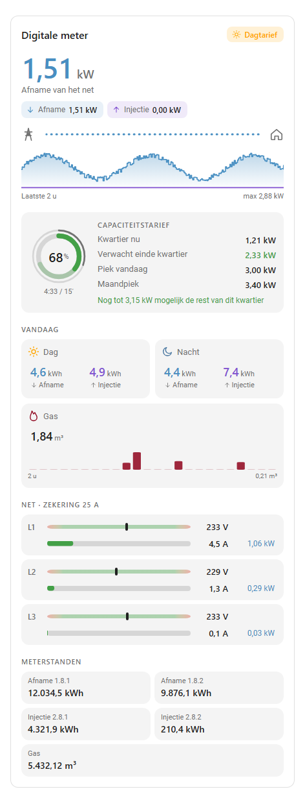
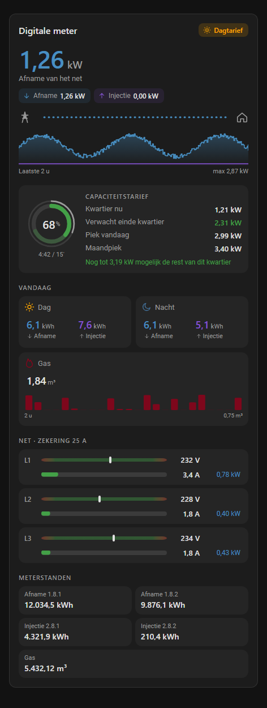
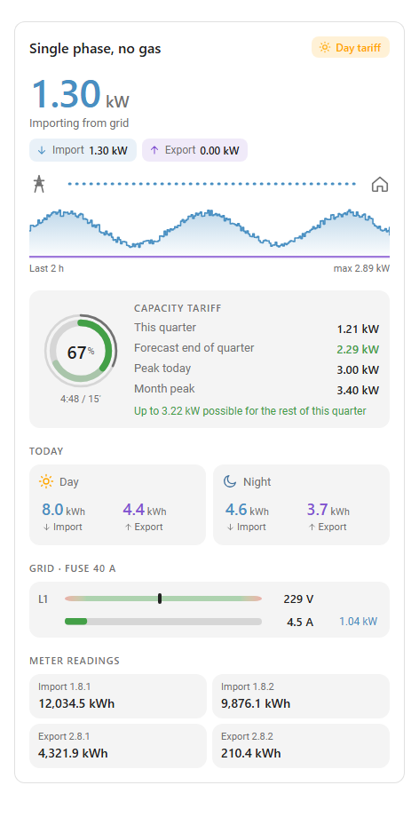

# Fluvius Meter Card

Custom Lovelace card for the Belgian digital meter: live import/export, capacity tariff
(quarter-hour forecast), today's usage per tariff, gas/water, per-phase voltage/current and
meter readings. Follows the active Home Assistant theme, including the energy colours.

Built with **Vue 3 + TypeScript + Vite** and shipped as a single JavaScript module.

<p>
  
  
  
</p>

*Light and dark theme (Dutch, three phases with gas) and an English single-phase setup without gas.
Screenshots come from the dev page with mocked data; regenerate them with `npm run screenshots`.*

## Install in Home Assistant

1. `npm install` then `npm run build`. The output is `dist/fluvius-meter-card.js`.
2. Copy it to `/config/www/fluvius-meter-card.js`.
3. **Settings → Dashboards → ⋮ → Resources → Add resource**
   URL `/local/fluvius-meter-card.js`, type *JavaScript module*.
4. Hard-refresh the browser and add the card via **Add card → Fluvius Meter Card**.
   Everything (entities, fuse, language, …) can be set in the visual editor.

When you update, bump `version` in `package.json` (it is logged in the browser console)
or add `?v=2` to the resource URL so browsers don't keep the old file.

## Development

| Command             | What it does                                                   |
| ------------------- | -------------------------------------------------------------- |
| `npm run dev`       | Dev page with two cards on a mocked `hass` (no HA needed)     |
| `npm run build`     | Type-check + production bundle in `dist/`                     |
| `npm test`          | Unit tests for the calculations and the editor mapping       |
| `npm run typecheck` | `vue-tsc` only                                                |
| `npm run screenshots` | Regenerate `docs/*.png` (needs Edge or Chrome; `BROWSER=` to override) |

## Layout

```
src/
  main.ts                    registers the elements + the "Add card" entry
  elements.ts                Vue custom elements + HA card API (setConfig, getCardSize, …)
  FluviusMeterCard.vue       root: theme tokens, remounts the card on config change
  const.ts                   default entities/options, resolveConfig()
  i18n.ts                    nl/en strings for card and editor
  types.ts                   config + minimal Home Assistant types
  composables/
    useMeter.ts              shared context (config, t, entities, power, history, stats) via provide/inject
    useEntities.ts           has/num/unit/kw helpers for configured entities
    usePowerHistory.ts       import/export series for the sparkline + forecast
    useStatistics.ts         today's totals, gas/water mini charts, peak today
    useClock.ts              5 s tick so the quarter ring keeps moving
  logic/                     pure functions (unit-tested): capacity forecast, series maths, formatting
  components/                one component per card section
  editor/                    visual editor (ha-form schema + mapping)
dev/                         mock hass + dev page entry (?theme=dark, ?card=1)
tests/                       vitest
scripts/screenshots.mjs      README screenshots → docs/
legacy/                      the original single-file card, for reference
```

### Notes

- Every `.vue` file is compiled in custom-element mode (`customElement: true` in
  `vite.config.ts`), so each component's `<style>` lands in the card's shadow root.
  All styles share that one shadow root, so keep class names distinct.
- Clicking any element with a `data-k="<entity key>"` attribute opens that entity's
  more-info dialog (one delegated listener in `MeterCard.vue`).
- To add an entity: add it to `EntityKey` (`types.ts`), `DEFAULT_ENTITIES` (`const.ts`),
  the editor schema and labels, then use `ent.kw("my_key")` and the other helpers in a component.

## License

[MIT](LICENSE)
